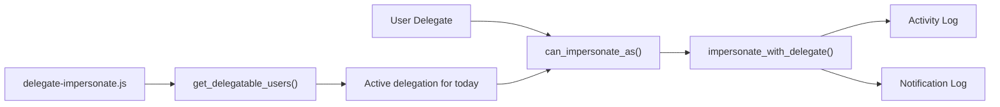

# Dinext Deputies

`Dinext Deputies` - это Frappe-приложение для управления временными замещениями и контролируемого входа от имени другого пользователя.

Приложение позволяет одному пользователю назначить заместителя на ограниченный период через DocType `User Delegate`. Если замещение активно на текущую дату, заместитель может войти от имени замещаемого пользователя из интерфейса Desk. Поток impersonation проверяется на backend, логируется в `Activity Log` и сопровождается уведомлением для пользователя, от имени которого выполняется вход.

## Назначение приложения

- хранит правила замещения в DocType `User Delegate`
- ограничивает действие замещения интервалом `from_date` - `to_date`
- добавляет маршрут `Мои замещения` в стандартный navbar
- показывает меню `Войти как..` в Desk, если текущий пользователь может impersonate другого пользователя сегодня
- требует обязательный комментарий перед impersonation
- логирует факт impersonation и уведомляет замещаемого пользователя
- расширяет стандартный механизм impersonation во Frappe, а не дублирует его целиком

## Ключевые сценарии

Приложение реализует два связанных, но разных потока.

### 1. Назначение замещения

DocType `User Delegate` определяет, кто кого замещает и в какие даты:

- `delegator`: замещаемый пользователь
- `delegate`: заместитель
- `from_date`: дата начала
- `to_date`: дата окончания

Клиентская и серверная валидация блокируют типовые ошибки:

- `delegator` и `delegate` не могут совпадать
- `to_date` не может быть раньше `from_date`
- обычный пользователь может назначать заместителя только себе
- тимлид ограничен собой и пользователями из своих функциональных групп

### 2. Вход от имени пользователя

Если замещение активно на текущую дату, заместитель видит в Desk меню `Войти как..`. При выборе пользователя открывается prompt с обязательным комментарием. Дальше приложение:

1. проверяет, разрешен ли impersonation для выбранного пользователя
2. записывает действие в `Activity Log`
3. создает запись в `Notification Log` для замещаемого пользователя
4. запускает стандартный impersonation Frappe через переопределенный backend-метод

## Архитектура

Заметная часть бизнес-логики распределена между Python-кодом, Desk JavaScript и экспортированными fixtures Frappe.



### Основные компоненты

- `dinext_deputies/hooks.py`
  Регистрирует fixtures, обязательные приложения, Desk JavaScript, маршрут в navbar и override стандартного метода impersonation во Frappe.
- `dinext_deputies/api.py`
  Возвращает список пользователей, от имени которых текущий пользователь может войти сегодня.
- `dinext_deputies/overrides/user.py`
  Оборачивает impersonation Frappe проверкой доступа, логированием и созданием уведомления.
- `dinext_deputies/dinext_deputies/doctype/user_delegate/user_delegate.py`
  Содержит основную backend-проверку `can_impersonate_as()`.
- `dinext_deputies/public/js/delegate-impersonate.js`
  Добавляет глобальное меню `Войти как..` в Desk и заставляет ввести комментарий перед impersonation.
- `dinext_deputies/fixtures/client_script.json`
  Содержит фактическое поведение формы `User Delegate`.
- `dinext_deputies/fixtures/server_script.json`
  Содержит API и серверную валидацию, связанную с логикой тимлидов и `User Delegate`.
- `dinext_deputies/fixtures/doctype_permission.json`
  Хранит scripted rules видимости для `User Delegate`.

## Требования и зависимости

### Требования к окружению

- Python `>=3.10`
- Bench-окружение с Frappe
- доступ к DocType `User` и стандартному интерфейсу Frappe Desk

### Обязательные приложения

В `hooks.py` задекларированы такие зависимости:

- `https://github.com/kittiu/doctype_permission.git`
- `https://dinord.gitlab.yandexcloud.net/erpnext/dinext/dinext_projects.git`

Они должны быть установлены в том же bench до установки `dinext_deputies`.

### Зависимости от данных окружения

Часть логики приложения опирается на уже существующие данные и DocType в целевом окружении:

- `User`
- `Has Role`
- `User Group`
- `User Group Member`
- `Teamleads Table`
- `Activity Log`
- `Notification Log`

Это означает, что приложение не является полностью автономным. Правила доступа для тимлидов зависят от фактического состава групп пользователей и записей о назначении тимлидов в целевом окружении.

## Роли и модель доступа

### `Administrator` и `System Manager`

- могут impersonate любого активного пользователя
- имеют доступ ко всем записям `User Delegate`
- не ограничены проверкой активного интервала замещения при impersonation

### `Dinext_User`

- может создавать записи замещения для самого себя
- видит только свои записи `User Delegate`
- получает поле `delegator`, зафиксированное на текущем пользователе в форме

### `Dinext_Team_Lead`

- получает расширенный доступ к записям `User Delegate` участников своих функциональных групп
- список доступных пользователей вычисляется по `User Group`, `User Group Member` и `Teamleads Table`
- backend-валидация запрещает назначать замещения вне разрешенного командного контура

## Установка

Устанавливайте приложение в уже существующий Administrator.

```bash
cd /path/to/frappe-bench

bench get-app https://github.com/kittiu/doctype_permission.git
bench get-app https://dinord.gitlab.yandexcloud.net/erpnext/dinext/dinext_projects.git
bench get-app <URL_OF_THIS_REPOSITORY> --branch develop

bench --site <site-name> install-app dinext_deputies
```

Если обязательные приложения уже установлены в bench, достаточно получить текущий репозиторий и выполнить `install-app` для нужного сайта.

## Как использовать

### Создание замещения

1. Откройте страницу `Мои замещения` или список `User Delegate`.
2. Создайте новую запись `User Delegate`.
3. Заполните:
   - `delegator`
   - `delegate`
   - `from_date`
   - `to_date`
4. Сохраните документ.

Правила валидации, которые применяет приложение:

- заместитель не может совпадать с замещаемым пользователем
- `from_date` не может быть раньше текущей даты на стороне клиента
- `to_date` должен быть больше или равен `from_date`

### Вход от имени замещаемого пользователя

1. Войдите под пользователем, который указан как `delegate` в активной записи замещения.
2. Дождитесь появления меню `Войти как..` в Desk.
3. Выберите пользователя из списка.
4. Введите обязательный комментарий в prompt.
5. Подтвердите действие.

После подтверждения приложение фиксирует действие в логах и отправляет уведомление замещаемому пользователю с введенным комментарием.

## Важные детали реализации

### Приложение переопределяет стандартный impersonation Frappe

Backend-метод `frappe.core.doctype.user.user.impersonate` переопределяется через `hooks.py`. Пользователь по-прежнему входит через стандартную точку входа Frappe, но приложение добавляет собственную авторизацию и аудит.

### Авторизация зависит от текущей даты

Для пользователей без административных прав impersonation разрешен только при наличии активной записи `User Delegate`, где:

- `delegator` - пользователь, от имени которого выполняется вход
- `delegate` - текущий пользователь сессии
- текущая дата находится между `from_date` и `to_date`

### Значимая часть логики находится в fixtures

Приложение намеренно опирается на экспортированные fixtures там, где обычно ожидают Python-модули:

- правила формы вынесены в `Client Script`
- часть серверной валидации вынесена в `Server Script`
- ограничения видимости вынесены в `DocType Permission`

При отладке и развитии приложения fixtures нужно проверять вместе с Python-кодом.

## Структура репозитория

```text
dinext_deputies/
├── dinext_deputies/
│   ├── api.py
│   ├── hooks.py
│   ├── overrides/user.py
│   ├── public/js/delegate-impersonate.js
│   ├── fixtures/
│   └── dinext_deputies/doctype/user_delegate/
├── pyproject.toml
└── README.md
```

## Разработка

### Pre-commit

В проекте используется `pre-commit` для линтинга и форматирования.

```bash
cd /path/to/frappe-bench/apps/dinext_deputies
pre-commit install
```

Используемые инструменты:

- `ruff`
- `eslint`
- `prettier`
- `pyupgrade`

### Заметки по тестированию

- `test_user_delegate.py` сейчас является заглушкой и не дает полноценного автоматического покрытия
- перед изменением логики замещения или impersonation нужно вручную проверить сценарий в реальном сайте Frappe
- если меняются fixtures, нужно проверить и поведение формы, и серверные проверки доступа

## Ограничения и заметки по сопровождению

- поведение тимлидов зависит от внешних бизнес-данных в `User Group`, `User Group Member` и `Teamleads Table`
- будущие и истекшие замещения не дают прав на impersonation, пока не стали активными на текущую дату
- контроллер DocType `user_delegate.js` фактически не используется, основная логика формы реализована через fixtures

## Лицензия

MIT
