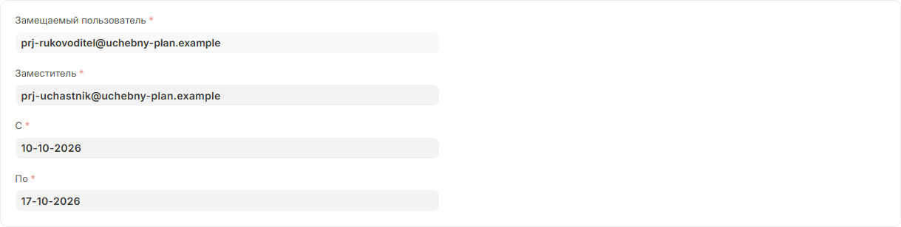
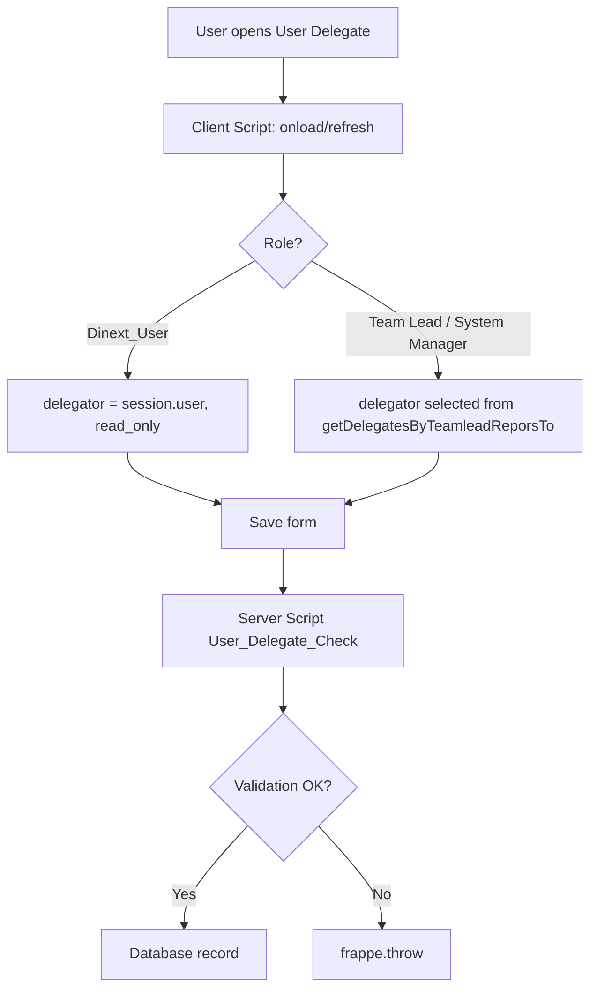
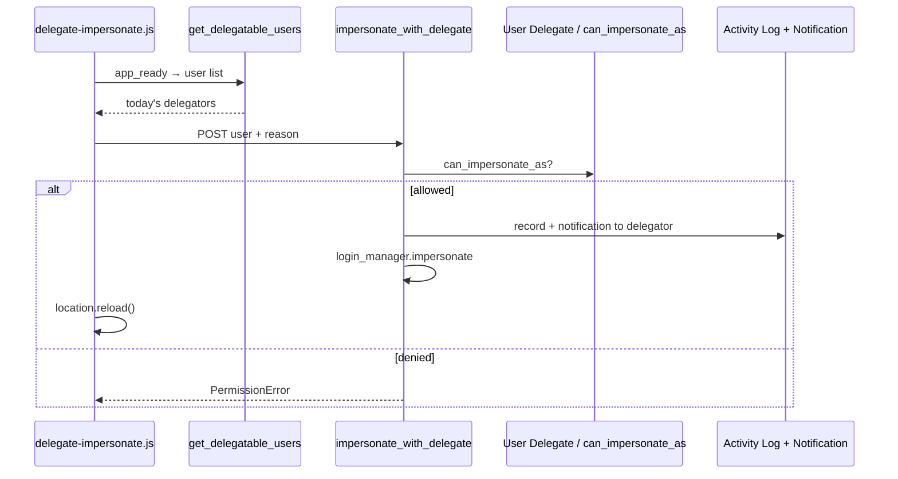

[Русский](README.ru.md)

<!-- dinext-presentation:start -->
<p align="center">
  <a href="https://dinext.ru"></a>
</p>
<h1 align="center">Dinext Deputies</h1>

<hr>

<p align="center">Time-limited user delegation with controlled sign-in on behalf of a colleague and an audit trail.</p>

<p align="center">
  
</p>
<p align="center"><sub>A delegation period configured with demonstration accounts.</sub></p>

<p align="center">
  <a href="https://dinext.ru">Website</a> · <a href="https://docs.dinext.ru">Documentation</a>
</p>
<!-- dinext-presentation:end -->

# Dinext Deputies

## 📖 Overview

**Dinext Deputies** is a Frappe application for the ERPNext Dinext stack. It lets you appoint user delegates for a specified period and securely sign in on their behalf (impersonate) only when an active delegation record exists.

The application integrates with `dinext_projects` (functional groups and team leads) and `doctype_permission` (flexible DocType permissions). It is published in Dinext GitLab and installed through bench.

## ✨ Features

- **User Delegate** — a DocType with fields for the delegator (`delegator`), delegate (`delegate`), and From / To dates.
- **My Delegations** — a navbar item with the `/app/user-delegate` route.
- **Sign in as..** — a navbar menu listing users you may impersonate today; a comment is required when impersonating.
- **Impersonation permission checks** — only an active delegate, or `System Manager` / `Administrator`.
- **Audit** — an Activity Log entry and a notification to the delegator (`Notification Log`).
- **DocType Permission** — record visibility for `Dinext_User`, `Dinext_Team_Lead`, `System Manager`.
- **Server Script** — validation on save (roles, team lead's team, dates, and prohibition on identical delegator/delegate values).
- **Client Script** — field filters, locking `delegator` for regular users, and client-side date validation.
- **API** — `get_delegatable_users`, `getDelegatesByTeamleadReporsTo`, `can_impersonate_as`.

## 🚀 Installation

```bash
cd $PATH_TO_YOUR_BENCH

# Dependencies (if not installed yet)
bench get-app https://github.com/kittiu/doctype_permission.git
bench get-app https://dinext.gitlab.yandexcloud.net/erpnext/dinext/dinext-projects.git

# Application
bench get-app https://dinext.gitlab.yandexcloud.net/erpnext/dinext/dinext-deputies.git --branch develop
bench install-app dinext_deputies
```

After `install-app`, fixtures from `dinext_deputies/fixtures/` are loaded (Server Script, Client Script, DocType Permission).

## 🛠️ Usage

### Assigning a delegation

1. Open **My Delegations** or the **User Delegate** list.
2. Create a record: delegator, delegate, start and end dates.
3. A regular user (`Dinext_User`) can appoint delegates only for themselves; a team lead can do so for themselves and members of their group; a `System Manager` has no restrictions on the delegator.

### Signing in on behalf of the delegator

1. On a date within the record's period, the delegate sees **Sign in as..** in the navbar.
2. Select a user and enter a comment — it will be sent to the delegator.
3. The session switches to the selected user (the page reloads).

`System Manager` and `Administrator` see all active users in the menu.

### Permissions for the User Delegate list

| Role | Visibility scope |
|------|-------------------|
| `Dinext_User` | Only records where `delegator = current user` |
| `Dinext_Team_Lead` | Records for members of their functional group |
| `System Manager` | Full access |

### Whitelisted API (examples)

```python
# Users available for impersonation today
frappe.call("dinext_deputies.api.get_delegatable_users")

# Permission check
frappe.call(
    "dinext_deputies.dinext_deputies.doctype.user_delegate.user_delegate.can_impersonate_as",
    user="user@example.com",
)
```

## 📦 Technologies

| Technology | Usage |
|------------|---------------|
| Python 3.10+ | Controllers, API, impersonation override |
| JavaScript | Client Script, `delegate-impersonate.js` |
| Frappe / ERPNext | DocType, hooks, fixtures, whitelisted methods |
| JSON | DocType schema, fixtures |
| flit / pyproject.toml | Package build |
| ruff, eslint, prettier | Linting and formatting (pre-commit) |

## 🔧 Configuration

The main configuration is in `dinext_deputies/hooks.py`:

| Parameter | Purpose |
|----------|------------|
| `required_apps` | `doctype_permission`, `dinext_projects` |
| `fixtures` | Server Script, Client Script, DocType Permission (Dinext Deputies module) |
| `standard_navbar_items` | My Delegations item → `/app/user-delegate` |
| `app_include_js` | `/assets/dinext_deputies/js/delegate-impersonate.js` |
| `override_whitelisted_methods` | `user.impersonate` → `impersonate_with_delegate` |

Application version: `dinext_deputies/__init__.py` (`__version__`).

Migrations: `dinext_deputies/patches.txt` (`[pre_model_sync]` / `[post_model_sync]` sections — no patches yet).

## ✅ Requirements

- [Administrator](https://github.com/frappe/bench) with Frappe/ERPNext installed (version according to your bench).
- Python >= 3.10 (`pyproject.toml`).
- Installed dependent applications: **doctype_permission**, **dinext_projects**.
- Dinext roles: `Dinext_User`, `Dinext_Team_Lead` (for group and team lead scenarios).

## 🤝 Contributing

```bash
cd apps/dinext_deputies
pre-commit install
```

API tests (on the `dev.dinext.ru` bench site with the application installed):

```bash
bench --site dev.dinext.ru run-tests --app dinext_deputies
```

Before a commit, ruff, eslint, prettier and pyupgrade run (see `.pre-commit-config.yaml`).

Common Dinext development rules: [AGENTS.md](AGENTS.md).

## 📄 Documentation

| Resource | Description |
|--------|----------|
| [AGENTS.md](AGENTS.md) | Agent navigation: registry, developer guide |
| [Frappe hooks](https://frappeframework.com/docs/user/en/python-api/hooks) | Hooks documentation |
| [license.txt](license.txt) | GPL-3 license |

### API and overrides

| Method / extension point | Description |
|---------------|----------|
| `dinext_deputies.api.get_delegatable_users` | Users for the Sign in as.. menu on the current date |
| `getDelegatesByTeamleadReporsTo` | Server Script API: delegates for a team lead / all users for administrators |
| `can_impersonate_as` | Impersonation permission check |
| `dinext_deputies.overrides.user.impersonate_with_delegate` | Replacement for the standard `user.impersonate` |

## 📝 Changelog

| Date | Commit | Changes |
|------|--------|-----------|
| 2026-05-10 | `96bc203` | User Delegate permissions (DocType Permission), hooks and fixture updates |
| 2026-02-02 | `308ee56` | Initial commit: User Delegate DocType, impersonation, client/server scripts |

## 🗂️ Repository Structure

```
dinext_deputies/                    # Frappe application root
├── README.md                       # Project documentation
├── AGENTS.md                       # Agent instructions
├── license.txt                     # GPL-3
├── pyproject.toml                  # Metadata, ruff, bench dev-dependencies
├── .pre-commit-config.yaml         # Pre-commit hooks
├── .editorconfig                   # Editor style
├── .eslintrc                       # ESLint for JS
└── dinext_deputies/                # Application Python package
    ├── __init__.py                 # __version__
    ├── hooks.py                    # required_apps, fixtures, navbar, overrides
    ├── api.py                      # get_delegatable_users
    ├── modules.txt                 # Dinext Deputies module
    ├── patches.txt                 # Database patches (empty)
    ├── config/                     # Reserved for bench configuration
    ├── overrides/
    │   └── user.py                 # impersonate_with_delegate
    ├── dinext_deputies/
    │   └── doctype/
    │       └── user_delegate/      # DocType: schema, can_impersonate_as
    ├── fixtures/
    │   ├── server_script.json      # API + Before Save validation
    │   ├── client_script.json      # User Delegate form
    │   └── doctype_permission.json # Role permissions
    ├── public/js/
    │   └── delegate-impersonate.js # Sign in as.. navbar menu
    └── templates/                  # ExampleCustomer08 (Frappe scaffolding)
```

| Path | Purpose |
|------|------------|
| `hooks.py` | Frappe integration point: dependencies, fixtures, JS, impersonation override |
| `api.py` | Whitelisted API: today's delegators for the current delegate |
| `overrides/user.py` | Impersonation with delegate checking, logging and notification |
| `doctype/user_delegate/` | Delegation model and `can_impersonate_as` |
| `fixtures/` | Portable Server/Client Script and DocType Permission records |
| `public/js/delegate-impersonate.js` | UI: button group and impersonation call |

## 🔗 Flow Chart

### Assigning a delegation (User Delegate)



### Impersonation (signing in as the delegator)


