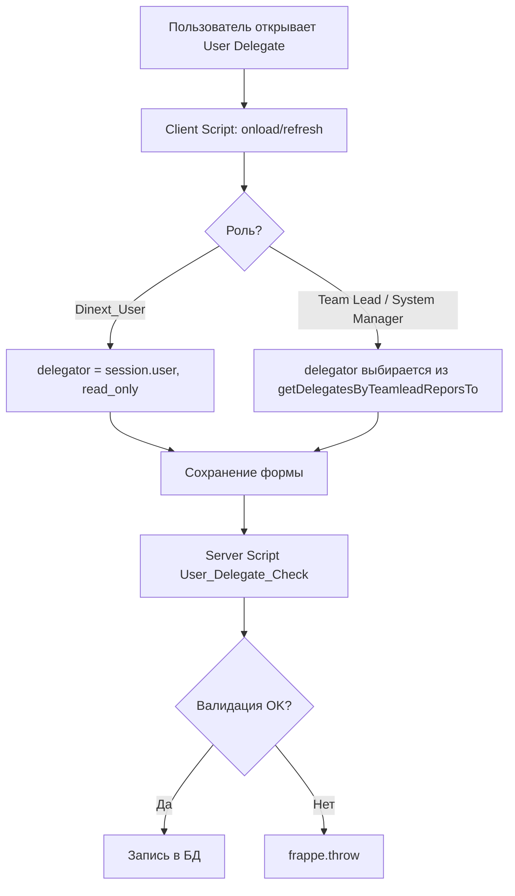
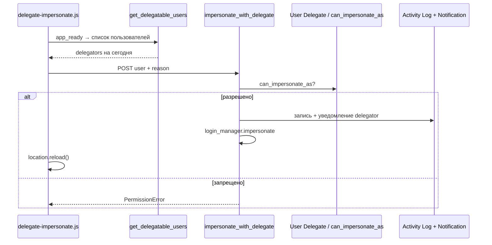

[English](README.md)

<!-- dinext-presentation:start -->
<p align="center">
  <a href="https://dinext.ru"></a>
</p>
<h1 align="center">Dinext Deputies</h1>

<hr>

<p align="center">Замещение пользователей на заданный период с контролируемым входом от имени коллеги и журналом действий.</p>

<p align="center">
  
</p>
<p align="center"><sub>Период замещения, настроенный для учебных учётных записей.</sub></p>

<p align="center">
  <a href="https://dinext.ru">Сайт</a> · <a href="https://docs.dinext.ru">Документация</a>
</p>
<!-- dinext-presentation:end -->

# Dinext Deputies

## 📖 Overview

**Dinext Deputies** — Frappe-приложение для стека ERPNext Dinext. Оно позволяет назначать заместителей пользователей на заданный период и безопасно входить в систему от их имени (impersonate) только при наличии активной записи замещения.

Приложение интегрируется с `dinext_projects` (функциональные группы и тимлиды) и `doctype_permission` (гибкие права на DocType). Публикуется в GitLab Dinext, устанавливается через bench.

## ✨ Features

- **User Delegate** — DocType с полями замещаемый (`delegator`), заместитель (`delegate`), период «С» / «По».
- **Мои замещения** — пункт navbar, маршрут `/app/user-delegate`.
- **Войти как..** — меню в navbar: список пользователей, под которых можно войти сегодня; обязательный комментарий при impersonate.
- **Проверка прав impersonate** — только активный делегат, либо `System Manager` / `Administrator`.
- **Аудит** — запись в Activity Log и уведомление замещаемому (`Notification Log`).
- **DocType Permission** — видимость записей для `Dinext_User`, `Dinext_Team_Lead`, `System Manager`.
- **Server Script** — валидация при сохранении (роли, команда тимлида, даты, запрет совпадения delegator/delegate).
- **Client Script** — фильтры полей, блокировка `delegator` для обычных пользователей, клиентская валидация дат.
- **API** — `get_delegatable_users`, `getDelegatesByTeamleadReporsTo`, `can_impersonate_as`.

## 🚀 Installation

```bash
cd $PATH_TO_YOUR_BENCH

# Зависимости (если ещё не установлены)
bench get-app https://github.com/kittiu/doctype_permission.git
bench get-app https://dinext.gitlab.yandexcloud.net/erpnext/dinext/dinext-projects.git

# Приложение
bench get-app https://dinext.gitlab.yandexcloud.net/erpnext/dinext/dinext-deputies.git --branch develop
bench install-app dinext_deputies
```

После `install-app` подтягиваются fixtures из `dinext_deputies/fixtures/` (Server Script, Client Script, DocType Permission).

## 🛠️ Usage

### Назначение замещения

1. Откройте **Мои замещения** или список **User Delegate**.
2. Создайте запись: замещаемый, заместитель, даты начала и окончания.
3. Обычный пользователь (`Dinext_User`) может назначать делегатов только для себя; тимлид — для себя и участников своей группы; `System Manager` — без ограничений по delegator.

### Вход от имени замещаемого

1. В день, попадающий в период записи, у заместителя в navbar появляется **Войти как..**.
2. Выберите пользователя, укажите комментарий — он отправится замещаемому.
3. Сессия переключится на выбранного пользователя (страница перезагрузится).

`System Manager` и `Administrator` видят в меню всех активных пользователей.

### Права на список User Delegate

| Роль | Область видимости |
|------|-------------------|
| `Dinext_User` | Только записи, где `delegator = текущий пользователь` |
| `Dinext_Team_Lead` | Записи участников своей функциональной группы |
| `System Manager` | Полный доступ |

### Whitelist API (примеры)

```python
# Список пользователей для impersonate сегодня
frappe.call("dinext_deputies.api.get_delegatable_users")

# Проверка права
frappe.call(
    "dinext_deputies.dinext_deputies.doctype.user_delegate.user_delegate.can_impersonate_as",
    user="user@example.com",
)
```

## 📦 Technologies

| Технология | Использование |
|------------|---------------|
| Python 3.10+ | Контроллеры, API, override impersonate |
| JavaScript | Client Script, `delegate-impersonate.js` |
| Frappe / ERPNext | DocType, hooks, fixtures, whitelisted methods |
| JSON | DocType schema, fixtures |
| flit / pyproject.toml | Сборка пакета |
| ruff, eslint, prettier | Линтинг и форматирование (pre-commit) |

## 🔧 Configuration

Основная конфигурация — в `dinext_deputies/hooks.py`:

| Параметр | Назначение |
|----------|------------|
| `required_apps` | `doctype_permission`, `dinext_projects` |
| `fixtures` | Server Script, Client Script, DocType Permission (модуль Dinext Deputies) |
| `standard_navbar_items` | Пункт «Мои замещения» → `/app/user-delegate` |
| `app_include_js` | `/assets/dinext_deputies/js/delegate-impersonate.js` |
| `override_whitelisted_methods` | `user.impersonate` → `impersonate_with_delegate` |

Версия приложения: `dinext_deputies/__init__.py` (`__version__`).

Миграции: `dinext_deputies/patches.txt` (секции `[pre_model_sync]` / `[post_model_sync]` — пока без патчей).

## ✅ Requirements

- [Administrator](https://github.com/frappe/bench) с установленным Frappe/ERPNext (версия согласно вашему bench).
- Python >= 3.10 (`pyproject.toml`).
- Установленные приложения-зависимости: **doctype_permission**, **dinext_projects**.
- Роли Dinext: `Dinext_User`, `Dinext_Team_Lead` (для сценариев с группами и тимлидами).

## 🤝 Contributing

```bash
cd apps/dinext_deputies
pre-commit install
```

Тесты API (на bench-сайте `dev.dinext.ru` с установленным приложением):

```bash
bench --site dev.dinext.ru run-tests --app dinext_deputies
```

Перед коммитом срабатывают: ruff, eslint, prettier, pyupgrade (см. `.pre-commit-config.yaml`).

Общие правила разработки Dinext: [AGENTS.md](AGENTS.md).

## 📄 Documentation

| Ресурс | Описание |
|--------|----------|
| [AGENTS.md](AGENTS.md) | Навигация агентов: registry, developer guide |
| [Frappe hooks](https://frappeframework.com/docs/user/en/python-api/hooks) | Документация по hooks |
| [license.txt](license.txt) | Лицензия GPL-3 |

### API и переопределения

| Метод / точка | Описание |
|---------------|----------|
| `dinext_deputies.api.get_delegatable_users` | Пользователи для меню «Войти как..» на текущую дату |
| `getDelegatesByTeamleadReporsTo` | Server Script API: делегаты для тимлида / все пользователи для админов |
| `can_impersonate_as` | Проверка права impersonate |
| `dinext_deputies.overrides.user.impersonate_with_delegate` | Замена стандартного `user.impersonate` |

## 📝 Changelog

| Дата | Коммит | Изменения |
|------|--------|-----------|
| 2026-05-10 | `96bc203` | Права User Delegate (DocType Permission), обновление hooks и fixtures |
| 2026-02-02 | `308ee56` | Начальный коммит: DocType User Delegate, impersonate, client/server scripts |

## 🗂️ Repository Structure

```
dinext_deputies/                    # Корень Frappe-приложения
├── README.md                       # Документация проекта
├── AGENTS.md                       # Инструкции для агентов
├── license.txt                     # GPL-3
├── pyproject.toml                  # Метаданные, ruff, bench dev-dependencies
├── .pre-commit-config.yaml         # Хуки pre-commit
├── .editorconfig                   # Стиль редактора
├── .eslintrc                       # ESLint для JS
└── dinext_deputies/                # Python-пакет приложения
    ├── __init__.py                 # __version__
    ├── hooks.py                    # required_apps, fixtures, navbar, overrides
    ├── api.py                      # get_delegatable_users
    ├── modules.txt                 # Модуль «Dinext Deputies»
    ├── patches.txt                 # Database patches (пусто)
    ├── config/                     # Зарезервировано под конфиг bench
    ├── overrides/
    │   └── user.py                 # impersonate_with_delegate
    ├── dinext_deputies/
    │   └── doctype/
    │       └── user_delegate/      # DocType: schema, can_impersonate_as
    ├── fixtures/
    │   ├── server_script.json      # API + Before Save валидация
    │   ├── client_script.json      # Форма User Delegate
    │   └── doctype_permission.json # Права по ролям
    ├── public/js/
    │   └── delegate-impersonate.js # Меню «Войти как..» в navbar
    └── templates/                  # ExampleCustomer08 (заготовки Frappe)
```

| Путь | Назначение |
|------|------------|
| `hooks.py` | Точка интеграции с Frappe: зависимости, fixtures, JS, override impersonate |
| `api.py` | Whitelist: список замещаемых на сегодня для текущего заместителя |
| `overrides/user.py` | Impersonate с проверкой делегата, логом и уведомлением |
| `doctype/user_delegate/` | Модель замещения и `can_impersonate_as` |
| `fixtures/` | Переносимые Server/Client Script и DocType Permission |
| `public/js/delegate-impersonate.js` | UI: группа кнопок и вызов impersonate |

## 🔗 Flow Chart

### Назначение замещения (User Delegate)



### Impersonate (вход как замещаемый)


